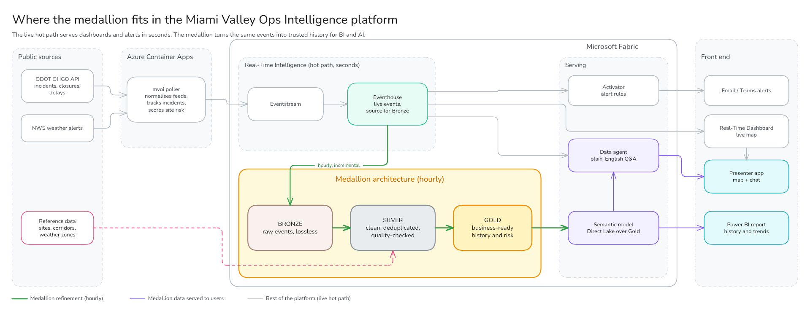

# Microsoft Fabric demo workspace

Working demos on Microsoft Fabric from **SD Labs at Smart Data**: complete,
deployable scenarios with their code, tests, Fabric item definitions and
documentation. Everything here uses public or synthetic data.

## Miami Valley Operations Intelligence

The first scenario, MVOI, shows minute by minute which important sites around
Dayton, Ohio face travel disruption from traffic incidents, road closures,
congestion and severe weather. It explains why, and keeps the full history for
trend and hot-spot analysis. It runs on Microsoft Fabric, fed by public ODOT
and National Weather Service data. The only component outside Fabric is a small
polling service.

> **About the sites.** The monitored sites are real public places and
> employers. MVOI is not affiliated with any of them. Scores are *inferred*
> travel-disruption exposure from public data near each site, and are not a
> statement about any site's operations.



### What it gives you

| Surface | What it gives |
|---|---|
| Real-Time Dashboard | Live KPIs, a map of incidents and weather alerts, ranked site exposure with plain-English reasons, pipeline health |
| Activator alerts | A notification when a site's exposure becomes high or data stops arriving |
| Power BI (Direct Lake) | Incident history, closure hours by corridor, weather-related share and hot spots |
| Data agent | Natural-language answers from curated KQL functions and a governed semantic model |

### How it works

- **Live path, seconds to minutes.** A container polls ODOT every 60 seconds
  and the NWS every 120 seconds, tracks each incident's lifecycle, scores site
  exposure and sends only the changes through Eventstream to an Eventhouse.
- **Historical path, hourly.** A pipeline copies new events into a Lakehouse
  and refines them through Bronze, Silver and Gold layers, adding geospatial
  analysis such as Getis-Ord Gi* hot spots.
- **Demo replay.** A synthetic storm runs through the same pipeline at up to
  60× speed, tagged and kept out of analytics and alerts.

Each site gets an explainable exposure score from 0 to 100:

```
exposure score = min(100, site importance × (incidents + road closures + slowdowns + weather + recent history))
```

Road events count fully within about 1 mile of a site and fade to zero at about
5 miles. Each component is capped so no single factor dominates, and an alert
is raised at 70.

### Try it locally, no cloud needed

Requires [uv](https://docs.astral.sh/uv/).

```bash
cd scenarios/miami-valley
uv sync --all-extras --group dev
uv run pytest -q
uv run mvoi replay synthetic
MVOI_PUBLISHER__KIND=stdout uv run mvoi replay start \
  --recording replay/recordings/synthetic-storm-and-crashes.jsonl --speed 60
```

### Use live data

The quick start above runs on synthetic data and needs no keys. To poll live
ODOT traffic data, register for a free OHGO API key at
https://publicapi.ohgo.com/accounts/registration, then run:

```bash
cd scenarios/miami-valley
OHGO_API_KEY=<your-key> MVOI_PUBLISHER__KIND=stdout uv run mvoi run --once
```

NWS weather alerts need no key.

### Deploy to Fabric

To deploy it, you need your own Fabric capacity and workspace: set
`workspace_name` in `scenarios/miami-valley/config/fabric.yaml`, then follow
the deployment guide.

## Documentation

| Read this | For |
|---|---|
| [Overview](scenarios/miami-valley/docs/overview.md) | Non-technical write-up: severity, exposure scoring and a worked example |
| [Architecture](scenarios/miami-valley/docs/architecture.md) | Data flow, hot and historical paths, replay isolation, design decisions |
| [Data sources](scenarios/miami-valley/docs/data-sources.md) | ODOT, NWS, TIGER and site data, polling and severity rules |
| [Data contracts](scenarios/miami-valley/docs/data-contracts.md) | The canonical event contract |
| [Deployment](scenarios/miami-valley/docs/deployment.md) | Prerequisites and step-by-step deployment |
| [Demo script](scenarios/miami-valley/docs/demo-script.md) | A 10-minute guided demonstration |
| [Power BI](scenarios/miami-valley/docs/power-bi.md) | Semantic model and report guide |
| [ArcGIS](scenarios/miami-valley/docs/arcgis.md) | GeoAnalytics usage, licensing and the fallback engine |
| [Costs](scenarios/miami-valley/docs/costs.md) | What it costs to run |
| [Troubleshooting](scenarios/miami-valley/docs/troubleshooting.md) | Common problems and useful KQL |
| [Scenario README](scenarios/miami-valley/README.md) | Code layout and capability status |
| [Architecture decisions](docs/adr/) | Why the repository and items are organized this way |

## Repository layout

```
scenarios/miami-valley/   Scenario code, tests, Fabric item definitions and docs
docs/adr/                 Architecture Decision Records
docs/brand/               SD Labs badge
.azure-pipelines/         Azure DevOps pipeline for the scenario
```

Fabric Git integration can use a `/workspace` folder in this repository. It is
created by Fabric on first commit.

## License

The code and documentation are available under the [MIT License](LICENSE). The
SD Labs name and badge are not covered by this license.
