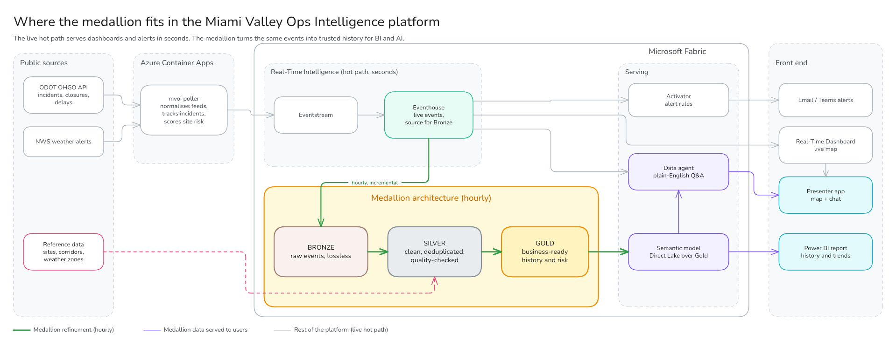
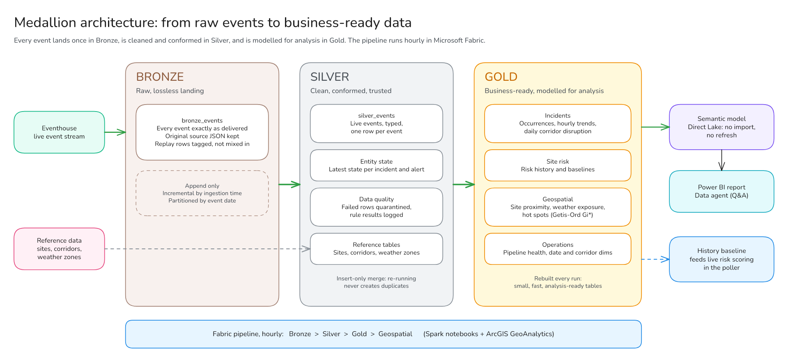

# Architecture

Miami Valley Operations Intelligence (MVOI) watches public transportation and
weather feeds for southwestern Ohio. It works out which monitored public
sites (venues, hospitals, the airport, major employers) face travel disruption, raises alerts when exposure changes, and keeps a full
history for trend and hot-spot analysis.

For a non-technical overview, including how severity and disruption exposure
are calculated, see [overview.md](overview.md).



The diagrams in `images/` are exported from Excalidraw: `medallion-in-context.png`
(above), `medallion-detail.png` (the Bronze, Silver and Gold layers, under
[Historical path](#historical-path-data-engineering)) and `architecture-medallion.png`
(the original single diagram, with its `.excalidraw` source).

## Data flow

```mermaid
flowchart LR
  subgraph Public sources
    OHGO[ODOT OHGO API<br/>incidents · construction ·<br/>dangerous slowdowns · travel delays]
    NWS[NWS api.weather.gov<br/>active alerts]
  end

  subgraph Azure Container Apps
    P[mvoi poller<br/>retry · ETag · lifecycle ·<br/>risk · alerts · outbox]
    R[mvoi replay<br/>recorded / synthetic<br/>responses]
    J[caj-example-resume-stream<br/>scheduled job]
  end

  subgraph Presenter laptop
    APP[mvoi-presenter<br/>localhost:8000]
  end

  subgraph Microsoft Fabric — ws-example
    ES[es_mvoi_events<br/>Eventstream<br/>custom endpoint]
    EH[(eh_mvoi / kqldb_mvoi<br/>Eventhouse · Events table ·<br/>EntityLatest MV · KQL functions)]
    RTD[rtd_mvoi_operations<br/>Real-Time Dashboard]
    ACT[act_mvoi_alerts<br/>Activator]
    subgraph lh_mvoi Lakehouse
      B[(Bronze<br/>bronze_events)]
      S[(Silver<br/>silver_events · DQ ·<br/>entity state)]
      G[(Gold<br/>occurrences · trends ·<br/>risk · proximity ·<br/>weather · hot spots)]
    end
    NB[Spark notebooks<br/>Python geospatial engine, ArcGIS optional<br/>pl_mvoi_medallion hourly]
    SM[sm_mvoi_historical<br/>Direct Lake model]
    PBI[Power BI<br/>historical report]
    DA[da_mvoi<br/>Data agent]
  end

  OHGO -->|60 s| P
  NWS -->|120 s| P
  P -->|Event Hubs protocol| ES
  R -->|same pipeline, run_mode=replay| ES
  ES -->|ProcessedIngestion| EH
  EH --> RTD
  EH -->|KQL source, 60 s| ACT
  EH -->|ingestion_time watermark| NB
  NB --> B --> S --> G
  G --> SM --> PBI
  G -.->|history_baseline.json| P
  EH -->|KQL functions| DA
  SM -->|DAX measures| DA
  RTD -->|Fabric Embed| APP
  DA -->|MCP| APP
  J -.->|resume paused destination| ES
```

## Hot path (operational intelligence)

| Stage | Component | What happens | Latency budget |
|---|---|---|---|
| Poll | `mvoi run` (Container App) | OHGO every 60 s (4 resources, map-bounds filtered, ETag), NWS every 120 s | 0–60 s (poll interval) |
| Normalise | `mvoi.sources.*` | Documented fields only → canonical `NormalizedEvent`; severity derived by explicit rules ([overview](overview.md#how-severity-is-calculated)); corridor by route-name alias, then spatial snap | ms |
| Lifecycle | `LifecycleTracker` + SQLite | created / updated / resolved / reopened. Duplicates are suppressed by content hash. Resolution needs N missed polls **and** M minutes. Truncated responses never mass-resolve. | ms |
| Risk + alerts | `mvoi.risk` | Facility exposure scores on material change ([overview](overview.md#how-disruption-exposure-is-calculated)); alert transitions with hysteresis and flap guard | ms |
| Deliver | transactional outbox → `EventHubPublisher` | At-least-once delivery with deterministic `event_id`; backlog survives outages and restarts | < 1 s |
| Route | `es_mvoi_events` | Custom endpoint → Eventhouse (ProcessedIngestion) | ~10–30 s |
| Serve | `kqldb_mvoi` | `Events` (30 d), `EntityLatest` materialized view, 24 KQL functions | query time |
| Visualise | `rtd_mvoi_operations` | Live updates (≥ 10 s, 30 s fallback) | 10–30 s |
| Alert | `act_mvoi_alerts` | KQL sources every 60 s, `ingestionDelay` 60 s | ~1–3 min |

End-to-end freshness from source change to dashboard is typically **under
2 minutes**. Worst case is about 60 s poll + 30 s Eventstream + 30 s dashboard.
OHGO publishes no upstream update frequency, so source-side lag is unknown and
is shown via `source_updated_at`.

### Why the poller computes risk and alert transitions

The polling service already holds every active entity in memory. Scoring
there in pure Python (`mvoi.risk.scoring`) means:

* The hot path (service) and the historical path (Gold notebooks) import the
  **same** module, so the dashboard and Power BI never disagree.
* Alert de-duplication (raise ≥ 70, clear < 60, 30-minute re-raise guard) is
  unit-testable instead of living in UI configuration.
* Activator only has to notify on `alert_state == "raised"`, which is a simple,
  robust rule.

Activator still owns the one alert the service cannot raise about itself:
**ingestion stopped**, a `NoHeartbeat` rule on the heartbeat stream.

## Historical path (data engineering)



| Table | Layer | Grain | Refresh | Notes |
|---|---|---|---|---|
| `bronze_events` | Bronze | event (as delivered) | append, hourly, watermark = Eventhouse `ingestion_time()` | Lossless: all columns + `raw_json` (original source record) + replay rows. Partitioned by `event_date`. |
| `silver_events` | Silver | event (`event_id` unique) | MERGE insert-only | Live only; typed; DQ-checked; duplicates removed |
| `silver_events_rejected` | Silver | event | append | Error-severity DQ failures (quarantine) |
| `silver_dq_results` | Silver | rule × run | append | Feeds pipeline-health reporting |
| `silver_entity_state` | Silver | entity | overwrite | Latest state per `entity_key` |
| `silver_facilities` / `silver_corridors` / `silver_zones` | Silver | reference | overwrite | From `reference-data/` |
| `gold_incident_occurrences` | Gold | **distinct occurrence** | overwrite | The counting unit for all trends and hot spots |
| `gold_incident_trends_hourly` | Gold | date × hour × corridor × type × severity | overwrite | |
| `gold_corridor_disruption_daily` | Gold | date × corridor | overwrite | closures, closure minutes, median duration |
| `gold_active_incidents` | Gold | entity | overwrite | Snapshot at last run |
| `gold_facility_risk_history` | Gold | risk snapshot | overwrite | Score + components + explanation |
| `gold_facility_proximity` | Gold | occurrence × facility | overwrite | Geodesic distance (ArcGIS or fallback) |
| `gold_weather_exposure` | Gold | alert × facility | overwrite | Polygon/zone intersection |
| `gold_incident_weather` | Gold | occurrence × alert | overwrite | Inside polygon **and** inside alert window |
| `gold_corridor_match` | Gold | occurrence | overwrite | Attribute vs spatial corridor match |
| `gold_hotspots` | Gold | grid bin | overwrite | Getis-Ord Gi* (`GiZScore`, `GiPValue`, `Gi_Bin`) |
| `gold_pipeline_health_daily` | Gold | date × source | overwrite | From heartbeats |
| `gold_facility_history_baseline` | Gold | facility | overwrite | + `Files/mvoi/exports/history_baseline.json` for the poller |
| `gold_date`, `gold_corridors` | Gold | dimension | overwrite | Conformed dimensions for Direct Lake |

**Incremental processing.** Bronze and Silver are incremental: a watermark plus
an insert-only MERGE, so re-running is a no-op. Gold tables are small (thousands
of rows), so they are recomputed in full each run. That is simpler and
self-healing, and costs seconds of Spark.

**Propagation.** `pl_mvoi_medallion` runs Bronze → Silver → Gold → Geospatial
hourly. The Direct Lake semantic model reads Delta directly, so Power BI sees
new Gold data as soon as the run commits, with no import refresh. The poller
re-reads `history_baseline.json` hourly.

### Hot-spot integrity

Repeated polling does not inflate statistics. The poller only emits on change,
and Gold collapses lifecycle events into **occurrences**: one continuous active
period of one entity. Hot spots count distinct occurrences (default) or weight
by incident-minutes (`hotspot_weighting = "minutes"`). A test covers this: one
incident observed for 180 polls produces one lifecycle event and one
occurrence (`tests/unit/test_lakehouse_logic.py`).

## Serving

| Consumer | Reads from | How | Notes |
|---|---|---|---|
| `rtd_mvoi_operations` (Real-Time Dashboard) | `kqldb_mvoi` | One KQL function call per tile; live updates | Pages: Presenter (KPIs + map, for embedding), Operations, Pipeline health. The map shows traffic incidents only (Presenter: within 3 miles of the picked site), one series per severity with the legend shown: the RTD map ignores `seriesColors` and rescales sizes to the data present, so colour comes from its palette (rows sorted by severity) and size is fixed. |
| `act_mvoi_alerts` (Activator) | `kqldb_mvoi` | KQL sources every 60 s | Notifies on `alert_state == "raised"` and on a missing heartbeat |
| Power BI report | `sm_mvoi_historical` | Direct Lake | No scheduled refresh; sees each pipeline run as it commits |
| `da_mvoi` (data agent, [ADR 0003](../../../docs/adr/0003-data-agent-naming-and-placement.md)) | `kqldb_mvoi` + `sm_mvoi_historical` | Routes "now" questions to KQL functions and history to DAX measures | Instructions and few-shots in `fabric/data-agent/`; consumes capacity CUs per question ([costs](costs.md)) |
| `mvoi-presenter` ([ADR 0004](../../../docs/adr/0004-local-presenter-app.md), [presenter.md](presenter.md)) | The dashboard + the data agent | Fabric Embed for the dashboard, the agent's MCP endpoint for chat; delegated sign-in | Runs on the presenter's laptop at `localhost:8000`; nothing is hosted |

The dashboard and the data agent both query the same stored KQL functions, so
a number on a tile and the agent's answer to the same question agree.

## Capacity suspend and resume

`ws-example` runs on a shared capacity that is suspended overnight. While it
is suspended, the poller keeps polling and its outbox holds what it cannot
send. Once the capacity resumes, the poller and the Eventstream source recover
by themselves, but the Eventstream's **Eventhouse destination stays Paused**,
so nothing reaches `Events`.

`caj-example-resume-stream` (a scheduled Container Apps job, `main.bicep`) runs
`mvoi resume-stream` at five past each hour from 11:05 to 22:05 UTC. It resumes
any paused destination with `startType = WhenLastStopped`, so the events queued
overnight backfill into `Events`, and it exits in seconds when everything is
already Running. It uses the poller's managed identity, which needs
Contributor on the workspace ([deployment.md](deployment.md)).

## Replay isolation

| Concern | Mechanism |
|---|---|
| Same processing path | Replay feeds recorded **raw API responses** through the real `parse_envelope` → lifecycle → risk → alerts → outbox → Eventstream |
| Distinguishable | Every event carries `run_mode = "replay"` and `replay_session_id`; synthetic records also carry `attributes.synthetic = true` |
| Separate state | One SQLite state DB per replay session; live state is never touched |
| No analytics contamination | Silver and Gold filter `run_mode = 'live'`; Bronze keeps replay rows for audit |
| Dashboards | `_mode` parameter (Live / Demo replay) on every tile; replay shows only the latest session |
| Alerts | Activator sources filter `run_mode == "live"` — demos never page anyone |
| Optional hard separation | Set `MVOI_REPLAY_EVENTSTREAM_CONNECTION_STRING` to send replay to a second Eventstream / workspace |

## Key design decisions

| Decision | Alternatives considered | Why |
|---|---|---|
| External poller in Container Apps | Fabric notebook on a 1-minute schedule; User Data Functions | Spark start-up (30–90 s) and per-run CU cost make minute-level notebooks wasteful; UDFs have no timer. An always-on 0.25 vCPU container costs about $10–20/month. |
| Eventstream custom endpoint (Event Hubs protocol) | Kafka endpoint; direct Kusto ingest | Fabric-native routing, Real-Time Hub visibility, and fan-out to more destinations later |
| Eventhouse `ProcessedIngestion` | `DirectIngestion` | The only mode that can be fully automated through the API. DirectIngestion needs a UI-created data connection. |
| Bronze pulled from Eventhouse by Spark | Eventstream → Lakehouse destination | The Lakehouse destination drops nested JSON (documented Eventstream gotcha), so Bronze would not be lossless |
| One canonical event envelope | One table per source | One landing table, one mapping, one contract; KQL functions and Silver fan out by `entity_type` |
| ArcGIS + pure-Python fallback | ArcGIS only | GeoAnalytics is bring-your-own-licence. The fallback writes the same schemas, so the demo never depends on a licence being active. |
| Scoring in Python, shared | KQL scoring; ML model | Explainable, configurable (`risk-scoring.yaml`), identical in both paths |
| Data agent over curated sources only ([ADR 0003](../../../docs/adr/0003-data-agent-naming-and-placement.md)) | Agent over the Lakehouse tables | Stored KQL functions and named DAX measures give consistent answers and fewer tokens per question |
| Local presenter app ([ADR 0004](../../../docs/adr/0004-local-presenter-app.md)) | Hosted web app; rebuilding the map outside Fabric | Fabric Embed keeps the real Fabric map; one presenter needs no hosting, and signs in with their own account |
| Scheduled resume job | Manual resume after each suspend; Activator or a Fabric pipeline | Fabric does not resume the destination automatically, and anything inside Fabric is itself suspended overnight |
