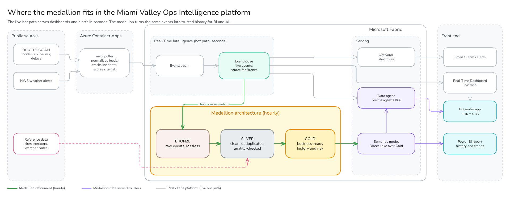
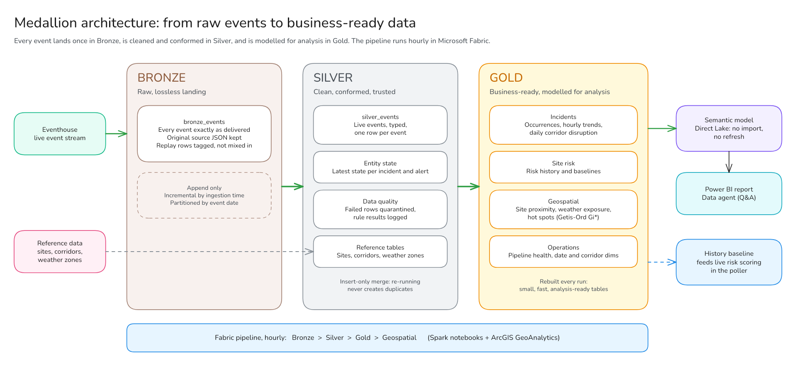

# Miami Valley Operations Intelligence: real-time site disruption on Microsoft Fabric

Miami Valley Operations Intelligence (MVOI) shows, minute by minute, which
important sites around Dayton face travel disruption from traffic incidents,
road closures, congestion and severe weather. It explains why, and keeps the
full history for trend and hot-spot analysis. It runs end to end on Microsoft
Fabric, fed by public ODOT and National Weather Service data. The only
component outside Fabric is a small polling service.

> **About the sites.** The 20 monitored sites are real public places and
> employers, centred on the demo host, Sinclair Conference Center (Sinclair
> Community College, Dayton). MVOI is not affiliated with any of them. Scores
> are *inferred* travel-disruption exposure from public data near each site.
> They are not a statement about any site's operations.

## The problem

Operations teams (logistics, facilities, event staff, hospital transport)
learn about disruption from scattered sources: a traffic map, a weather app,
a phone call. None of these answers the question that matters: *which of our
sites is affected right now, how badly, and why?* Afterwards, nobody can say
whether a site's problems are getting worse, or which corridors cause them.

MVOI answers both questions from one pipeline:

- **Right now:** a live map and ranked list of sites by disruption exposure,
  each with a plain-English reason, plus alerts when a site crosses a
  threshold. Typically under 2 minutes from a road event to the dashboard.
- **Over time:** history of every incident occurrence, closure hours by
  corridor, weather-related share, and statistically significant hot spots.
- **In plain English:** a data agent that answers questions such as
  "Which sites are most exposed right now?" or "Which corridor had the most
  closure hours last month?"

## What the app shows

| Surface | Audience | What it gives |
|---|---|---|
| Real-Time Dashboard | Operations desk | Live KPIs, a live map of traffic incidents by severity, weather alerts, a ranked site exposure table with explanations, open alerts, pipeline health |
| Activator alerts | On-call staff | A notification when a site's exposure becomes high, a major incident is close to a site, a weather warning covers one, or data stops arriving |
| Power BI report | Analysts, management | Trends, corridor disruption, weather overlap, hot spots, history of each site's exposure |
| Data agent | Anyone | Plain-English questions over both the live data and the history |
| Presenter app | Demo presenter | One branded page combining the live dashboard and the data agent chat |

## How severity is calculated

Every incident on the map and in the **Active incidents** table has a
severity: **critical**, **major**, **moderate** or **minor**. ODOT's feed does
not include a severity field, so MVOI derives one from fields ODOT does
publish, using simple, explainable rules. The first rule that matches wins.

**Traffic incidents** (crashes, hazards, disabled vehicles and similar):

| Severity | Rule | Example |
|---|---|---|
| Critical | The description or category mentions a fatality, hazardous materials, a wrong-way driver, a bridge strike or collapse, or a tanker | "Tanker rollover, I-75 SB" |
| Major | ODOT reports the road as **closed** | "Crash, all lanes closed" |
| Moderate | The road is **partially closed**, or the text describes a crash, collision, rollover, disabled vehicle, debris, vehicle fire or injury | "Crash on right shoulder" |
| Minor | Anything else | "Maintenance vehicle on shoulder" |

**Other road events** use the measurement ODOT provides:

| Event type | Major | Moderate | Minor |
|---|---|---|---|
| Construction | — | Road closed | Otherwise |
| Dangerous slowdown | Speed 60% or more below normal | 40–60% below normal | Less than 40% below normal |
| Travel delay | Delay of 20 minutes or more | 10–20 minutes | Under 10 minutes |

**Weather alerts** keep the National Weather Service's own severity:
Extreme, Severe, Moderate, or Minor/Unknown.

Speeds and delays change slightly every minute, so they are grouped into these
bands before MVOI decides whether an incident has changed. A 2 mph wobble is
not reported as an update. The exact readings are still stored.

## How disruption exposure is calculated

Each site gets a **disruption exposure score from 0 to 100**, recalculated
whenever something nearby changes. The score adds up five kinds of exposure,
caps each one so that no single factor dominates, and then adjusts for how
important the site is:

```
exposure score = min(100, site importance × (incidents + road closures + slowdowns + weather + recent history))
```

### 1. Distance matters

Road events count fully within about **1 mile** (1.6 km) of a site. Their
weight then falls in a straight line to zero at about **5 miles** (8 km).
Anything farther away is ignored. An incident 3 miles away therefore counts
roughly half as much as one next door.

### 2. The five components

| Component | Points, at full distance weight | Cap |
|---|---|---|
| **Incidents** (traffic incidents and construction) | Critical 30, major 20, moderate 10, minor 4, for each event | 45 |
| **Road closures** | 15 extra for each nearby event that closes the road | 25 |
| **Slowdowns** (dangerous slowdowns and travel delays) | 6 for each event | 15 |
| **Weather** (the site is inside an active warning area) | Extreme 35, severe 25, moderate 12, minor 5, unknown 3 | 35 |
| **Recent history** (distinct incidents within 2 miles in the last 30 days) | 1.5 for each incident | 15 |

Weather is not reduced by distance. Either the site is inside the warning's
area or it is not. Recent history comes from the Lakehouse (Gold layer). It is
refreshed hourly and sent back to the live scoring service.

### 3. Site importance

Each site has an importance rating from 1 to 5. This is MVOI's own weighting
for the demo, not a rating of the organisation. It scales the total:

| Importance | 1 | 2 | 3 | 4 | 5 |
|---|---|---|---|---|---|
| Multiplier | ×0.70 | ×0.85 | ×1.00 | ×1.15 | ×1.30 |

The airport, the main hospitals and the conference venue are rated 5.

### 4. Bands and alerts

| Score | 0–24 | 25–49 | 50–69 | 70–84 | 85–100 |
|---|---|---|---|---|---|
| Band | Low | Guarded | Elevated | High | Severe |

An alert is **raised** when a site reaches 70. It **clears** only when the
score falls below 60, so a score hovering around 70 doesn't keep notifying.
The same site can't be raised again within 30 minutes of clearing.

### Worked example (illustrative)

Suppose Sinclair Conference Center (importance 5) has this nearby:

| Nearby condition | Distance | Weight | Points |
|---|---|---|---|
| Major crash with the road closed | 0.7 mi | 100% | 20 incident + 15 closure |
| Moderate crash | 3 mi | 50% | 5 incident |
| Dangerous slowdown | 1.85 mi | 78% | 4.7 slowdown |
| 4 incidents nearby in the last 30 days | — | — | 6 history |
| **Total before importance** | | | **50.7** |

50.7 × 1.30 = **65.9**, which is **Elevated**. The dashboard shows this
explanation, exactly as the scoring code generates it:

> Disruption exposure elevated (66) due to 2 nearby roadway incidents
> (nearest 0.7 mi), 1 with road closure, 1 nearby slowdown/travel delay and
> elevated recent incident history (4 occurrences nearby); site importance 5
> amplifies the score. Inferred from public traffic and weather data near the
> site; not a statement about the site's operations.

If a severe thunderstorm warning then covered the site (+25), the total would
reach (50.7 + 25) × 1.30 = 98.4, which is **Severe**, and an alert would be raised.

### Why this approach

- **Explainable.** Every point can be traced to a specific event, and the
  explanation names the largest contributors. There is no black-box model to
  defend.
- **Tunable.** All weights, caps, distances and thresholds live in one
  configuration file (`config/risk-scoring.yaml`), so they can be changed
  without code.
- **Consistent.** The live service and the historical Lakehouse use the same
  scoring code, so the dashboard and Power BI never disagree.
- **Honest.** The score measures *exposure*: something disruptive is near the
  site, or a warning covers it. It does not claim that a delivery or a route
  was actually affected.

## Architecture



Data takes two paths, both starting from the same polling service:

- **Live path** (seconds to minutes). A small container polls ODOT every
  60 seconds and the NWS every 120 seconds. It normalises each record,
  assigns severity, tracks each incident's lifecycle (created, updated,
  resolved), scores site exposure and raises alerts. It then sends only the
  changes to a Fabric **Eventstream**. The Eventstream lands them in an
  **Eventhouse** (KQL database), which feeds the Real-Time Dashboard,
  Activator and the data agent.
- **Historical path** (hourly). A Fabric pipeline copies new events from the
  Eventhouse into a **Lakehouse** and refines them through a Bronze, Silver
  and Gold **medallion architecture**. A **Direct Lake** semantic model serves
  the result to Power BI and the data agent, with no import refresh.



| Layer | Purpose | Highlights |
|---|---|---|
| Bronze | Raw and lossless | Every event exactly as delivered, including the original JSON and replay rows, for audit and reprocessing |
| Silver | Clean and conformed | Typed, de-duplicated, quality-checked events (bad rows are quarantined, not lost), the current state of each incident, and the reference tables (sites, corridors, weather zones) |
| Gold | Business-ready | Distinct incident occurrences, hourly trends, daily corridor disruption, site exposure history, and geospatial results: proximity, weather exposure and Getis-Ord Gi* hot spots, from a built-in Python engine (ArcGIS GeoAnalytics is optional and needs an Esri licence) |

Repeated polling never inflates the statistics. One incident watched for three
hours is counted as one occurrence, not 180.

**Demo replay.** A recorded or synthetic storm can be replayed through the
exact same pipeline at up to 60× speed. Replayed events are tagged and kept
out of the analytics and alerts, so a demo never pollutes real data or pages
anyone.

## Running it

| Area | How it is handled |
|---|---|
| Cost | One Fabric capacity (F2 is enough day to day; scale up on demo day). Azure hosting for the poller costs about $10–20 a month. The ODOT and NWS APIs are free. |
| Overnight shutdown | The shared capacity pauses overnight to save cost. A scheduled job resumes the Eventstream each morning, and the events queued overnight are filled in. |
| Reliability | Delivery is guaranteed at least once, and backlogs survive restarts. Duplicates are removed by event ID. A partial upstream response can't mass-resolve incidents, and an alert fires if data stops arriving. |
| Deployment | Scripted and repeatable: Bicep for Azure, plus a single `deploy_fabric.py` that creates or updates every Fabric item by name. |
| Data responsibility | Public data only. Sites are real but unaffiliated, and every score is labelled as inferred. |

## Why Microsoft Fabric

- **One platform** for streaming, data engineering, BI, alerting and AI: one
  security model, one capacity to manage, no glue services.
- **Real-time and historical together.** The same events serve a live
  dashboard in seconds and a governed Lakehouse within the hour.
- **Open formats.** Delta tables in OneLake are readable by Spark, SQL,
  Power BI (Direct Lake) and partners such as Esri.
- **AI on governed data.** The data agent answers from the curated semantic
  model and KQL functions, not from raw tables.

## Applying the pattern elsewhere

The parts that are specific to Dayton are configuration: the area of
interest, the corridors, the site list and the scoring weights. The same
design applies wherever location-based events have to be tied to the places
an organisation cares about, for example:

- delivery depots and routes;
- hospital and clinic networks;
- utility assets and field crews;
- retail store networks;
- event venues and campuses.
